# AWS Lista 2

## Wykonaj backup bazy danych używany przez aplikację do S3
Zgodnie z intrukcją na stronie [Amazon RDS Backup & Restore Using AWS Backup](https://aws.amazon.com/getting-started/hands-on/amazon-rds-backup-restore-using-aws-backup/) wykonałem krok 2, czyli stworzyłem on-demand AWS Backup job dla bazy danych AWS RDS stworzonej dla aplikacji.

Backup został aktywowany w trybie natychmiastowym (czas wykonania 1h), natomiast retencja została ustawiona na 5 tygodni.

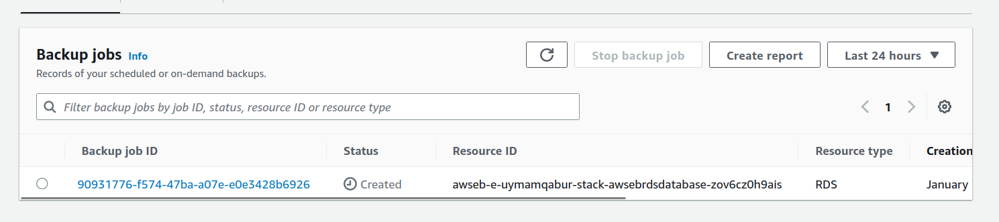

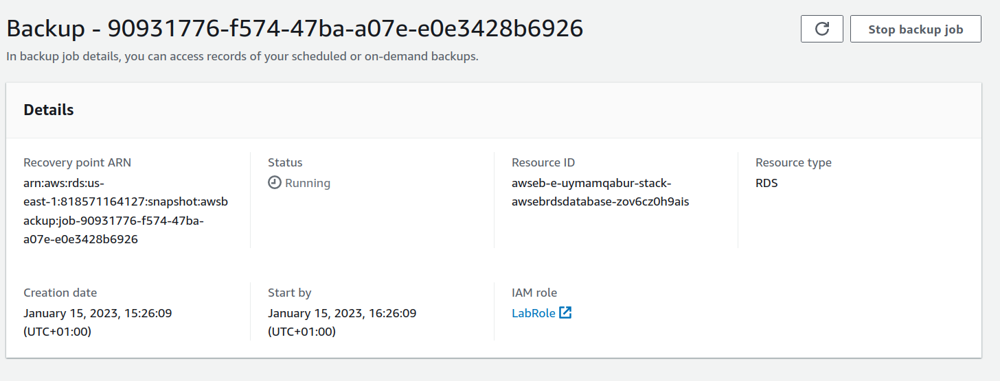

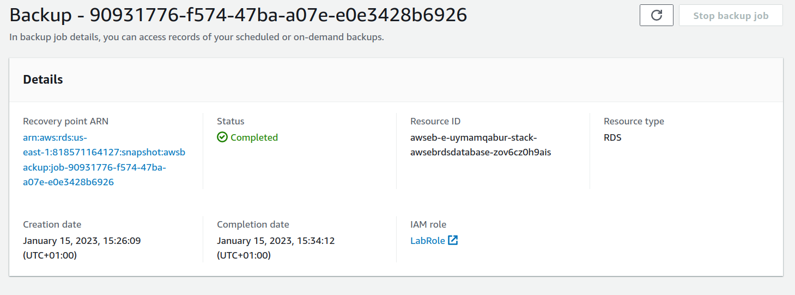

## Użyj zapisanego backupu bazy danych, aby przywrócić dane do bazy danych używanej przez aplikację

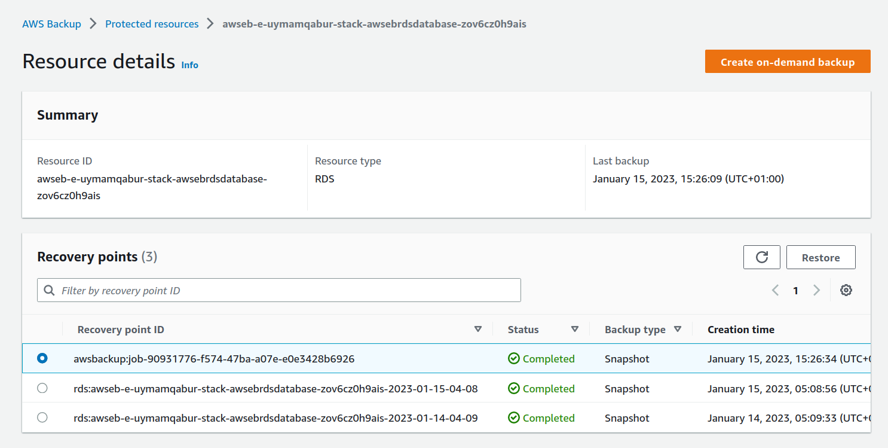

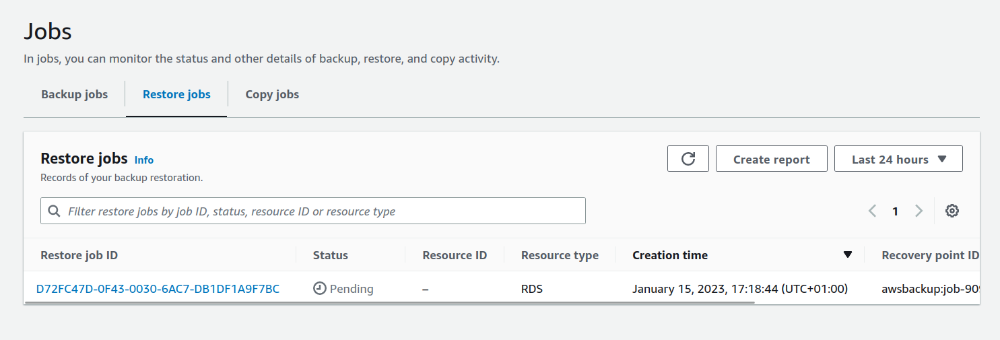

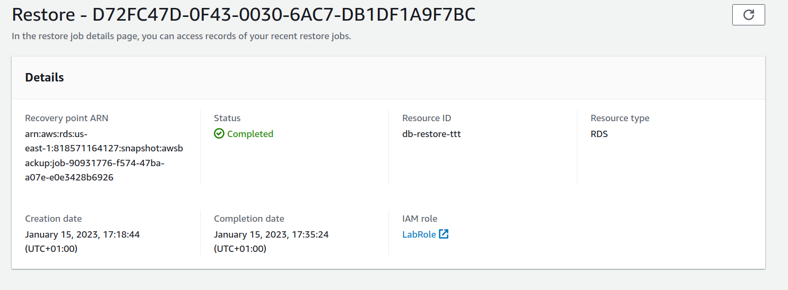

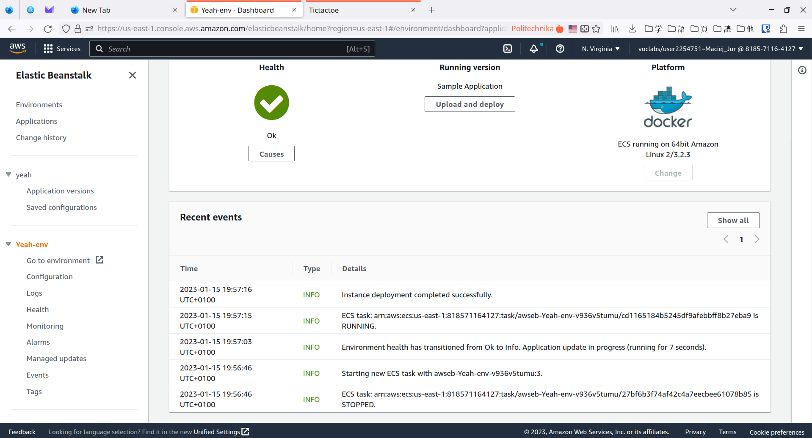

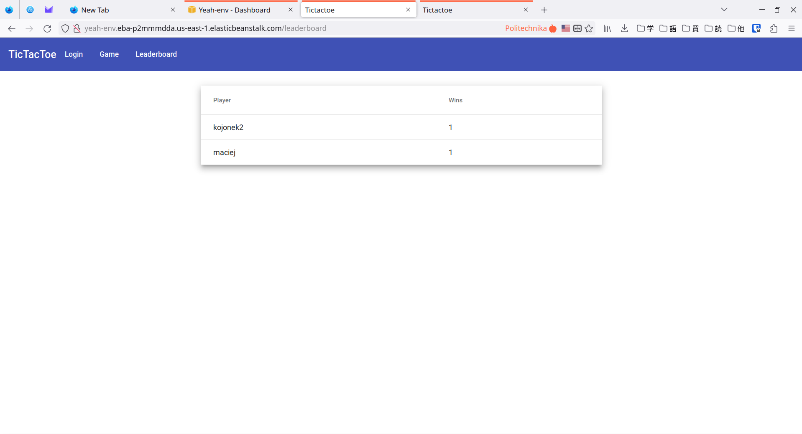

## Utwórz konfigurację dla Cloudwatch a następnie zdefiniuj własny alarm

Korzystając z AWS CloudWatch stworzyłem alarm dla wykorzystania CPU w klastrze ECS dla środowiska aplikacji webowej. Jako threshold alarmu ustawiłem 50%.

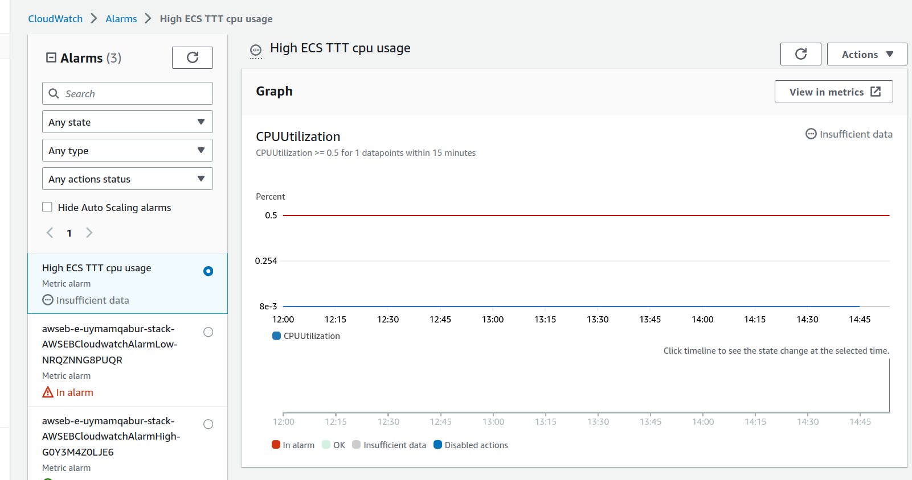

## Utwórz konfigurację dla CloudTrail oraz sprawdź historię eventów

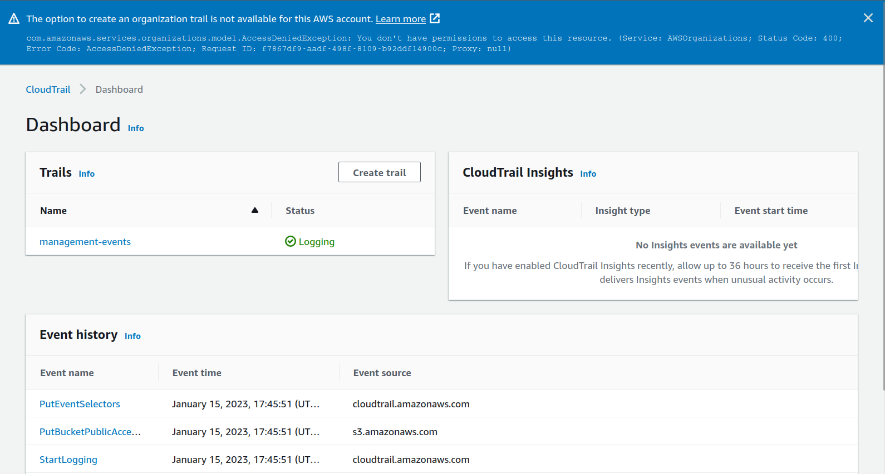

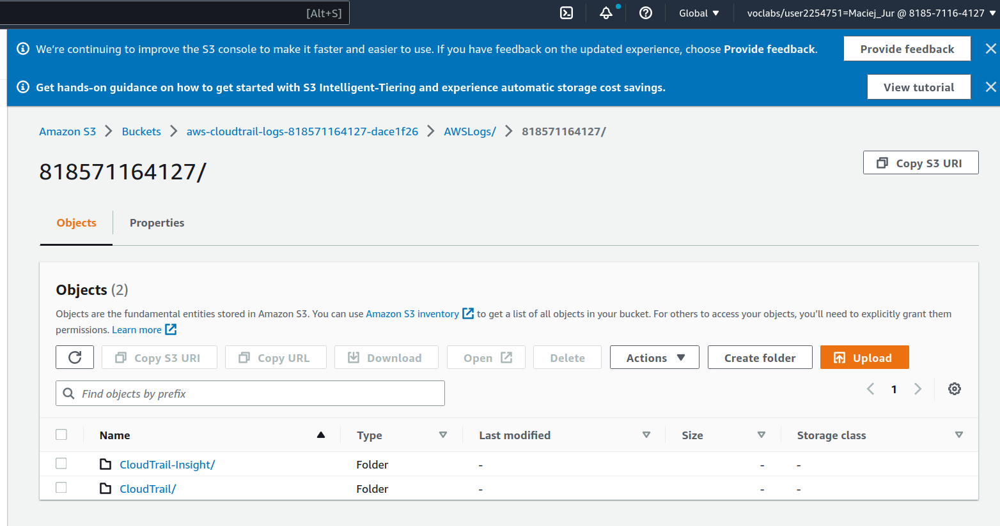

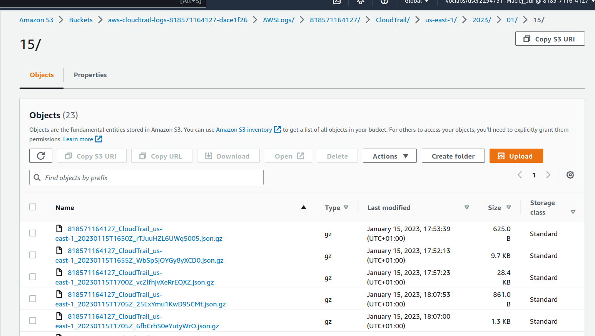

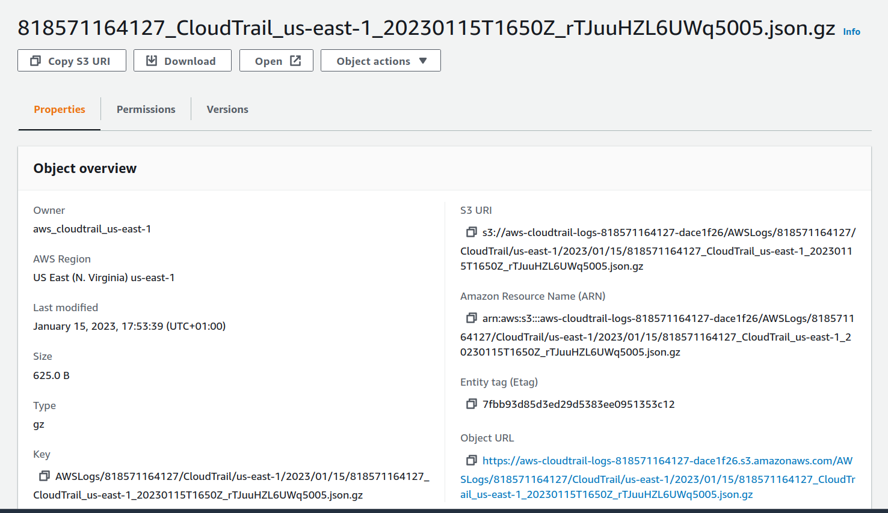

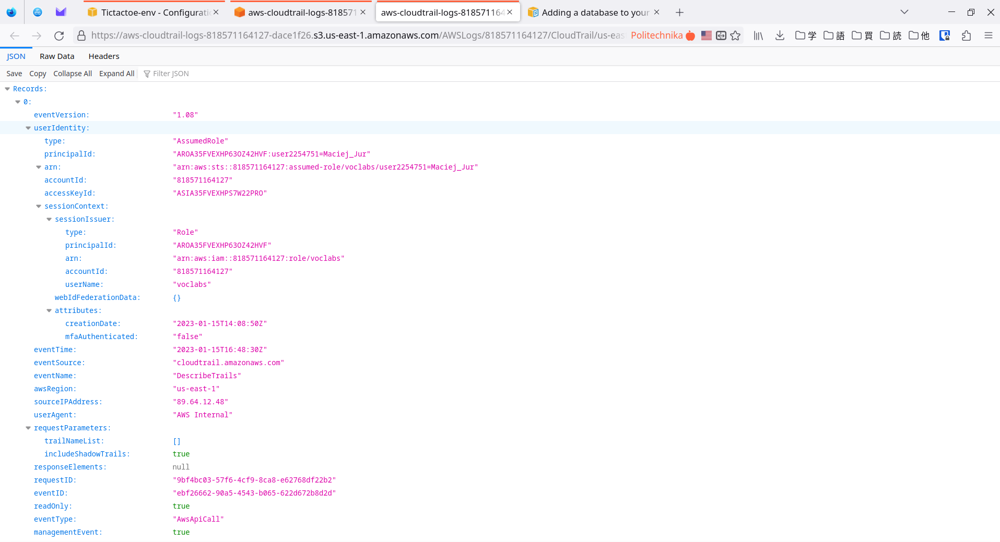

## Wykorzystaj AWS Inspector w swojej aplikacji

Próbując włączyć AWS Inspector na koncie studenckim AWS Academy natrafiłem na błąd uprawnień:

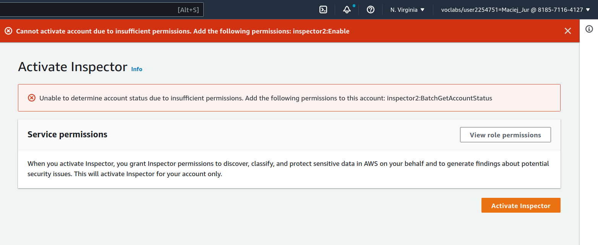

Ale po przełączeniu na wersję klasyczną udało się uruchomić tę usługę.

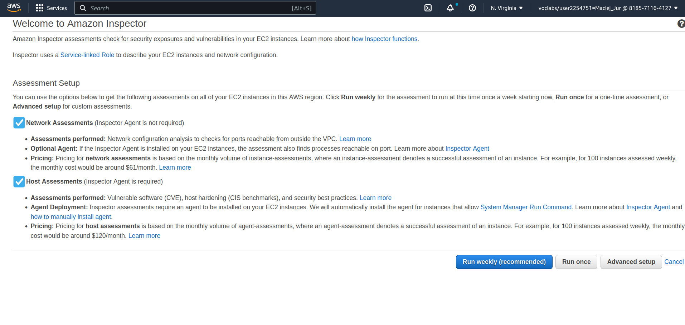

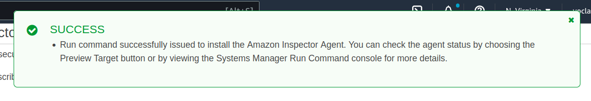

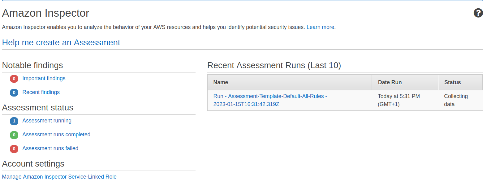

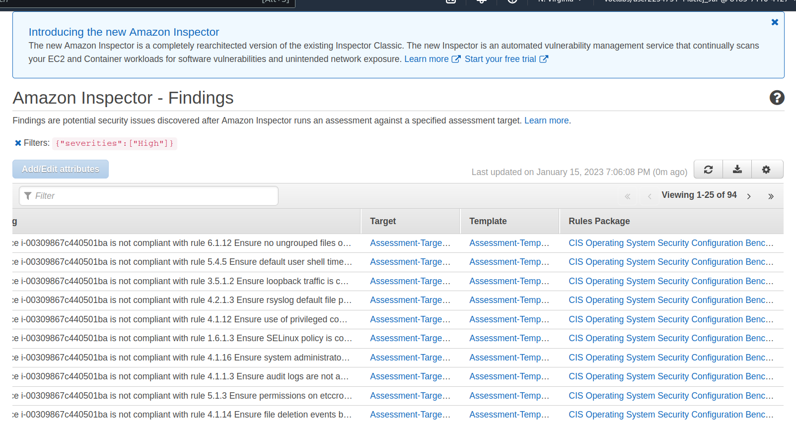