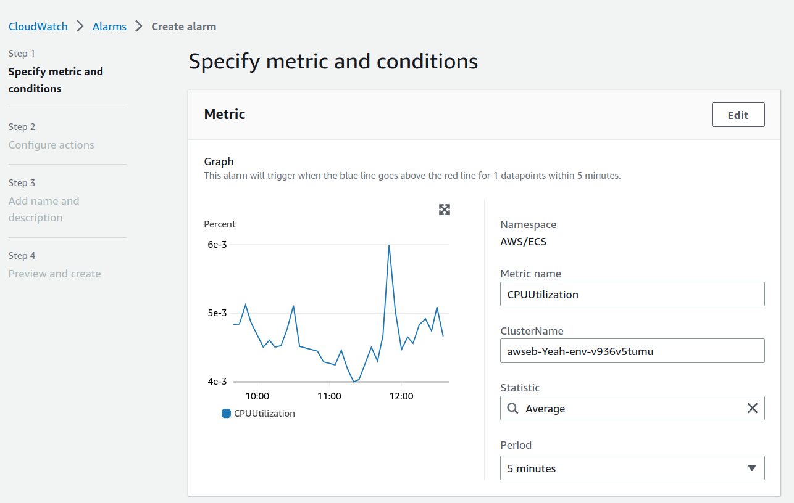
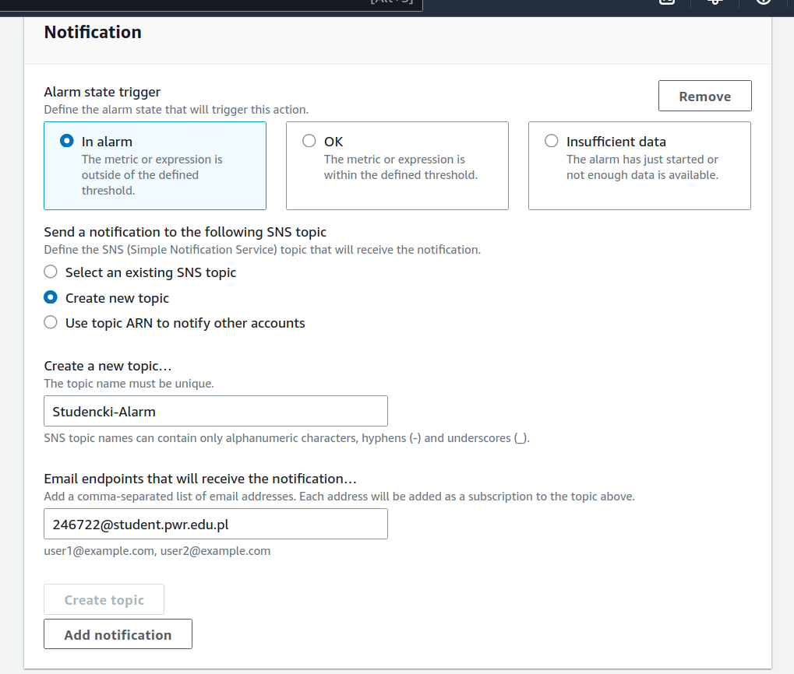
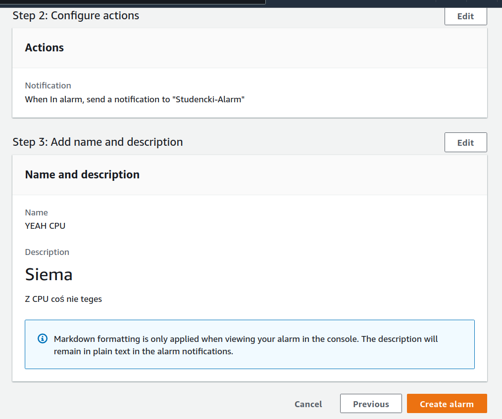
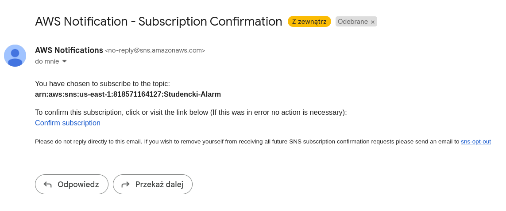
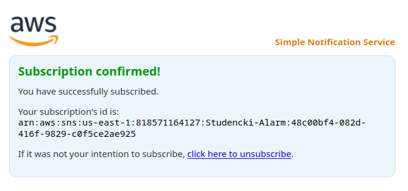
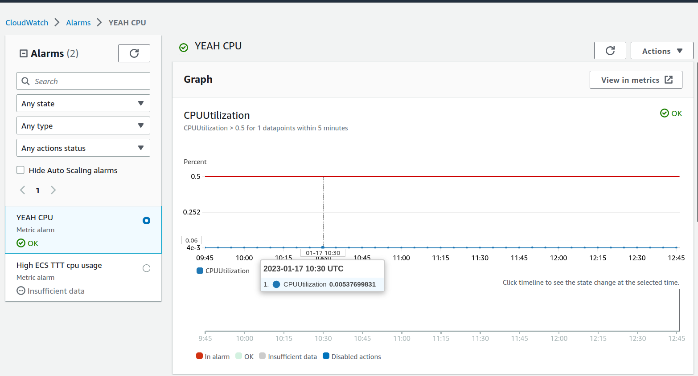
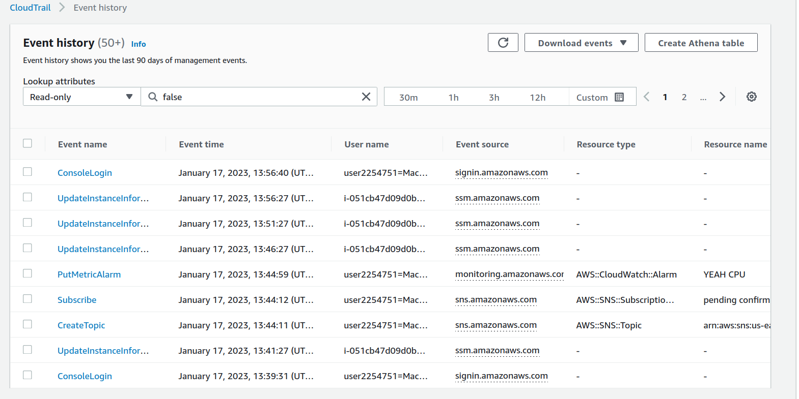

# AWS Lista 2

## Wykonaj backup bazy danych używany przez aplikację do S3
Zgodnie z intrukcją na stronie [Amazon RDS Backup & Restore Using AWS Backup](https://aws.amazon.com/getting-started/hands-on/amazon-rds-backup-restore-using-aws-backup/) wykonałem krok 2, czyli stworzyłem on-demand AWS Backup job dla bazy danych AWS RDS stworzonej dla aplikacji.

Backup został aktywowany w trybie natychmiastowym (czas wykonania 1h), natomiast retencja została ustawiona na 5 tygodni.

Po wykonaniu backupu pojawia się informacja o statusie "Completed" dla danego job'a w usłudze AWS Backup.

## Użyj zapisanego backupu bazy danych, aby przywrócić dane do bazy danych używanej przez aplikację

W usłudze AWS Backup widoczne są dostępne punkty przywracania, gdzie w tym przypadku pierwszym punktem przywracania jest snapshot wykonany manualnie przeze mnie.

Po wykonaniu polecenia przywracania bazy danych ze snapshotu pojawia się nowy job w zakładce `Restore jobs`.

Po wykonaniu przywrócenia przez AWS widoczny jest status `completed`.

Poniżej wydoczna jest aplikacja korzystająca z przywróconych danych aplikacji. Nadal ma ona dostępne stare dane aplikacji co widoczne jest po wejściu na `Leaderboard`.

## Utwórz konfigurację dla Cloudwatch a następnie zdefiniuj własny alarm

Korzystając z AWS CloudWatch stworzyłem alarm dla wykorzystania CPU w klastrze ECS dla środowiska aplikacji webowej. Jako threshold alarmu ustawiłem 50%.

Poniżej jest widoczna definicja tematu SNS dla alarmu.

Skonfigurowany alarm ma ustawione emaile, na które ma wysyłać emaile w przypadku wystąpienia sytuacji alarmowej.

## Utwórz konfigurację dla CloudTrail oraz sprawdź historię eventów

W usłudze CloudTrail włączyłem logowanie dla domyślnych eventów, a dodatkowo włączyłem `CloudTrail Insights` aby logowało anomalie związane z API rate'ami.

W usłudze S3 pojawiły się foldery na logi z usługi CloudTrail.

Każdy jeden plik jest skompresowany, ale można go podejrzeć w przeglądarce w formacie JSON.

Poniżej widoczne są eventy CloudTrail, między innymi ustawianie alertów, oraz logowanie do konsoli.

## Wykorzystaj AWS Inspector w swojej aplikacji

Próbując włączyć AWS Inspector na koncie studenckim AWS Academy natrafiłem na błąd uprawnień:

Ale po przełączeniu na wersję klasyczną udało się uruchomić tę usługę.

Poniżej widoczna jest informacja o włączeniu badania potencjalnych problemów z aplikacjami. Statud jest `running`.

Po wykonaniu badania AWS Inspector udostępnia listę znalezionych problemów związanymi z konfiguracją aplikacji oraz ich bezpieczeństwem.

